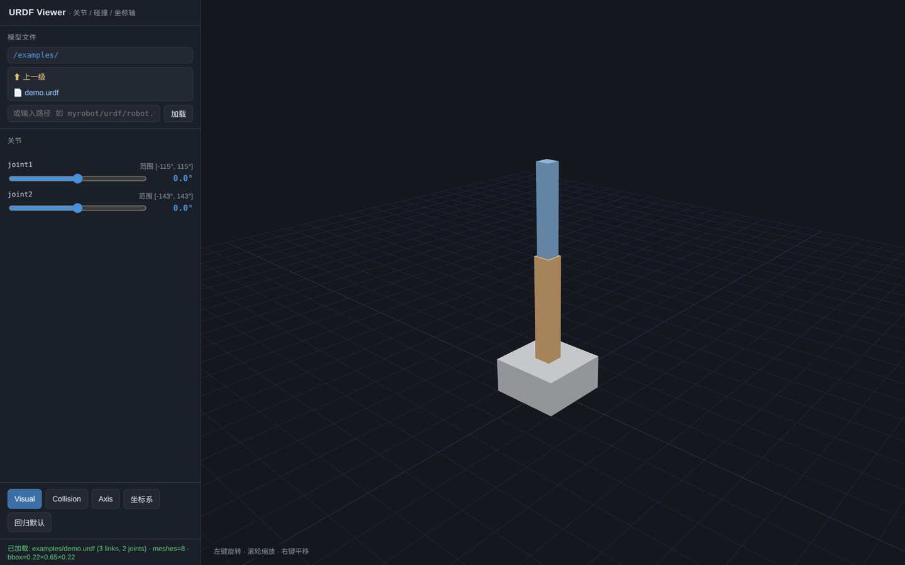
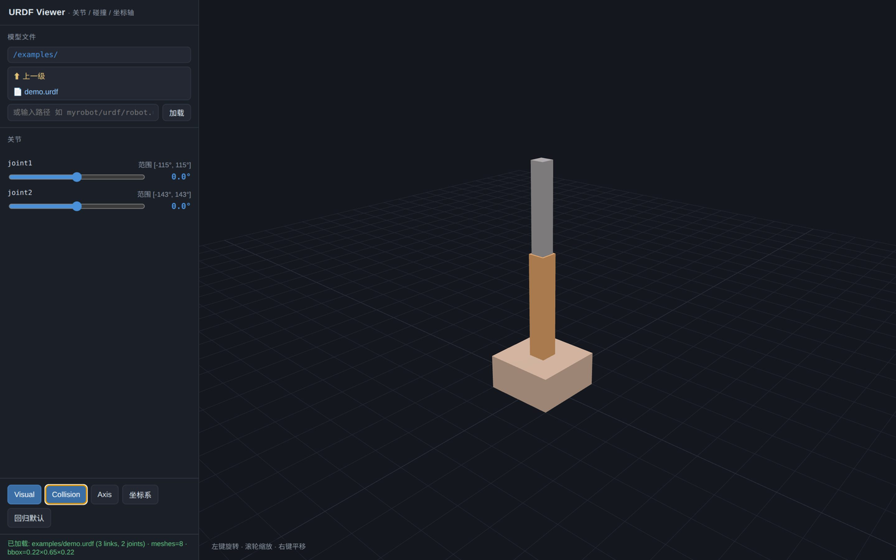

# URDF Viewer

[English](README.md) · **中文**

一个纯浏览器、零安装的 URDF 查看小工具。打开 `.urdf`，拖动关节滑条，切换碰撞体、关节轴与 link 坐标系——不需要 ROS，不需要构建，也不需要任何 Python 包。

> **在线演示**：<https://yihuan01.github.io/urdf-viewer/>
> 自带示例会自动加载。文件浏览器依赖服务器的目录索引，GitHub Pages 没有，需在路径框手填 `examples/demo.urdf`。



## 依赖

- **Python 3**：仅用于起目录服务（`http.server`），不需要第三方包。
- 现代浏览器（Chrome / Edge / Firefox / Safari）。
- three.js 与 urdf-loader 通过 unpkg CDN 加载，**首次打开需联网**。要完全离线用，把两个库下到本地并改 `index.html` 里的 importmap。

## 快速开始

```bash
cd urdf-viewer
./start_viewer.sh          # 默认端口 8975，会自动尝试打开浏览器
./start_viewer.sh 9000     # 自定义端口
```

也可以手动起服务（自带脚本额外提供文件浏览器用的目录列表接口）：

```bash
python3 serve.py 8975
# Windows：python serve.py 8975
```

直接用 `python3 -m http.server 8975` 也能看模型，但它不会列出含 `index.html` 的目录，此时需手填 URDF 路径。

然后打开 <http://127.0.0.1:8975/index.html>。

**不要双击 `index.html`**：`file://` 下浏览器禁止读取网格文件，只会得到白屏。

## 放置你自己的模型

- 把 `index.html`、URDF 和网格文件放在同一个目录（可分子目录），在左侧「模型文件」里逐级点选 `.urdf`。
- 也可以在下方输入框手填相对路径，例如 `myrobot/urdf/robot.urdf`。
- URDF 里的网格路径按 **URDF 文件所在目录** 解析，写成相对路径最稳：
  ```xml
  <mesh filename="../meshes/base_link.stl"/>
  ```
- 不解析 `package://`（那需要 ROS 环境），遇到请改成相对或绝对路径。
- URL 加 `?root=../other_robot/` 可浏览页面目录之外的文件夹。
- `examples/demo.urdf` 是一个纯几何体的两连杆手臂，不需要网格文件，适合快速验证工具是否正常。

## 功能

| 区域 | 功能 |
|---|---|
| **模型文件** | 浏览目录、选择 `.urdf` 文件加载；也可手动输入路径。 |
| **关节面板** | 每个活动关节一根滑条，显示关节名、范围（旋转关节单位度，移动关节单位米）和实时数值；拖动即联动。没有限位的关节（如轮子）自动放开到 ±180°。 |
| **Visual** | 显示/隐藏视觉网格。默认开。 |
| **Collision** | 显示/隐藏碰撞体（橙色半透明）。默认关。 |
| **Axis** | 显示/隐藏各关节的旋转/移动轴箭头（黄色）。默认关。 |
| **坐标系** | 显示/隐藏每个 link 的局部坐标系（红 = X，绿 = Y，蓝 = Z）。默认关。 |
| **回归默认** | 所有关节归零、恢复默认开关、相机复位。 |

打开 Collision 开关后的碰撞体显示：



**鼠标操作**：左键拖动 = 旋转，滚轮 = 缩放，右键拖动 = 平移。

## 已知限制

- 必须通过 HTTP 服务打开，`file://` 不可用。
- `.xacro` 会出现在文件列表里，但**不会展开宏**，只能加载纯 URDF。
- 目录浏览优先问自带的 `serve.py`（JSON 接口），拿不到再解析服务器的 HTML 目录索引。两者都没有的服务器（如 GitHub Pages）会显示空列表，需手填路径。
- 模型按 **Z-up** 假设摆正（绕 X 轴 −90°）。Y-up 模型需改 `index.html` 里的 `robot.rotation.x`。
- 没有动画播放、IK、多机器人场景。

## 第三方

- [three.js](https://threejs.org/) r160 — MIT
- [urdf-loader](https://github.com/gkjohnson/urdf-loader) 0.12.3 — Apache-2.0

两者都在运行时从 unpkg 拉取，本仓库不重新分发它们的代码。

## 许可

[MIT](LICENSE) © 2026 Yihuan01

个人自用工具，按现状分享：不保证维护，也没有路线图；随便 fork、随便改。
